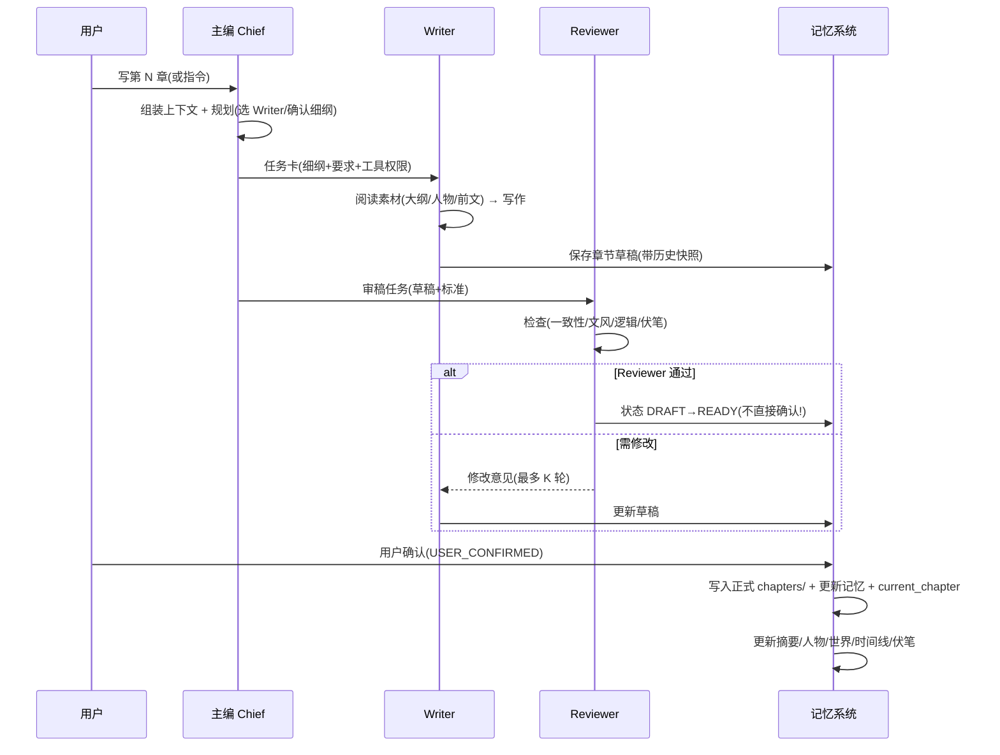

# ARCHITECTURE — 系统架构设计

## 1. 总体架构

**Core Engine(核心引擎, 无 UI 依赖)+ Adapter(界面适配层)**。

Core 层不依赖 argparse/click/终端输入输出, 以后做 GUI 时无需重写核心。
M0–M7 使用 CLI Adapter 快速验证, Desktop UI Adapter 留待以后。

```mermaid
graph TB
    subgraph Adapter 层(可替换)
        CLI[CLI Adapter<br/>M0-M7 测试用]
        GUI[Desktop UI Adapter<br/>以后实现]
    end
    subgraph Core Engine(无 UI 依赖)
        WF[Workflow 编排]
        AR[Agent Runtime]
        PJ[Project 管理]
        MEM[Memory 系统]
        TLB[Tools 注册表]
        PR[Providers 接入]
    end
    subgraph 数据层
        FS[文件系统<br/>data/novels/*]
        CFG[config/settings.json<br/>非敏感]
        SS[SecretStore<br/>系统凭据管理器]
    end
    CLI --> WF
    GUI --> WF
    WF --> AR
    AR --> TLB
    AR --> PR
    TLB --> PJ
    TLB --> MEM
    PJ --> FS
    MEM --> FS
    PR --> CFG
    PR --> SS
```

## 2. 分层职责与依赖规则

| 层 | 职责 | 依赖规则 |
|---|---|---|
| **Adapter** | 命令解析(CLI) / 窗口事件(GUI), 把用户输入变成 Core 调用 | 只依赖 Core 公开接口 |
| **Core: Workflow** | 主编→Writer→Reviewer 编排、状态机、记忆更新触发 | 依赖 Agent Runtime / Tools / Memory |
| **Core: Agent Runtime** | Agent 循环(system prompt + tool_calls 解释), 与模型格式无关 | 依赖 Provider 接口(不依赖具体 HTTP 格式) |
| **Core: Project** | 项目 CRUD、章节读写、大纲/人物/世界管理 | 依赖文件系统 |
| **Core: Memory** | 记忆读取/更新(派生数据) | 依赖 Project + LLM(摘要) |
| **Core: Tools** | 工具注册/执行/权限/路径校验/历史快照 | 依赖 Project / Memory |
| **Core: Providers** | BaseProvider 接口 + OpenAI 兼容实现 + SecretStore + 动态预算 | 无内部依赖(最底层) |

**强制规则**: Core 各模块禁止 import argparse/click/sys.stdin/stdout; Adapter 层负责所有终端交互。Core 可被 Python 库方式调用与单测。

## 3. 核心运行循环(每轮对话/写作)

```
1. Adapter 收到用户输入 → Workflow 路由(默认主编)
2. Agent Runtime 组装上下文包(见 §4) + 系统提示词
3. Provider.chat(...) → 流式输出(内部数据模型, 非 OpenAI 格式裸传)
4. 若返回 tool_calls:
   a. Tools 执行(权限/路径校验/历史快照)
   b. 结果回填 → 继续(≤ max_tool_rounds)
5. 最终文本 → Adapter 展示
6. 若发生章节确认 → Memory 更新(摘要/人物/世界/时间线/伏笔)
```

## 4. 上下文管理 — ContextBudget 动态预算

**原则: 全书永不整体进入 prompt; 预算按模型动态计算。**

### ContextBudget 计算(含硬上限)

```
可用上下文 = max_context_tokens(模型能力配置)
            - 输出预留(reserve_output, 默认 4096 token, 长文任务可更高)
            - 系统提示词长度
            = 输入预算上限

输入预算上限 → 按优先级逐段填充上下文包, 超出部分裁剪
```

**恒等式(必须永远成立)**:

```
system_prompt + input_context + tool_results + reserve_output ≤ max_context_tokens
```

**每类上下文都有硬上限**(P0 是最高优先级, 不是无限大小):

| 类别 | 优先级 | 硬上限(默认, 可配置) |
|---|---|---|
| current_chapter_plan(当前章细纲) | P0 | 2000 token |
| active_characters(当前人物) | P0 | 2000 token |
| recent_text(最近正文节选) | P0 | 4000 token |
| current_volume_outline(当前卷大纲) | P1 | 3000 token |
| foreshadowing(活跃伏笔) | P1 | 1200 token |
| memory(最近摘要等) | P1/P2/P3 | 3000 token(按优先级裁剪) |
| world_state(世界状态) | P2 | 1500 token |
| long_term(长期记忆) | P2 | 1200 token |

- 每类在预算内各自截断; 若 P0 合计已超过输入预算上限, **优先压缩/摘要 P0**(而非整体超预算请求)。
- 压缩策略: 截断到类上限 → 仍超则 LLM 摘要(单段) → 仍超则错误提示用户缩小任务范围。

### 上下文优先级

| 优先级 | 内容 | 来源 | 裁剪策略 |
|---|---|---|---|
| **P0** | 当前章细纲 / 当前人物设定 / 最近正文(2 章结尾) | outline/chapters/、characters/、chapters/ | 类硬上限内不可再丢(只可压缩) |
| **P1** | 当前卷大纲 / 活跃伏笔 / 最近章节摘要 | outline/volumes/、memory/foreshadowing/、memory/summaries/ | 按预算截断 |
| **P2** | 世界状态 / 长期记忆 / 人物状态 | memory/world/、memory/long_term.md、memory/characters/ | 只放摘要 |
| **P3** | 较旧相关章节摘要 / 完整历史 | memory/summaries/ | 超出即丢弃(或单条超短) |

> 25-30K token 不是固定默认值, 只是"大上下文模型"场景下由预算算出的可能结果。小上下文模型(如 32K)自动获得更小的输入预算, 且每类硬上限随之缩放(按比例, 但 P0 硬上限不低于最小值)。

### 裁剪规则

- 按 P0→P3 顺序填充, 到预算上限停止; P3 最先被丢弃。
- 单条超长内容(如章节正文)先截断, 再考虑丢弃。
- 章节完成后: 正文 → 章节摘要(LLM 压缩) → 按章存入 `memory/summaries/chNNNN.md`; 正文本体只进 P0(最近 2 章结尾片段)。
- 人物/世界状态: 每章确认后增量更新(LLM 比对旧状态 + 新章 → 新状态)。

## 5. 多 Agent 写作流(核心流程)



> 章节状态机与"用户确认"边界详见 DATA_MODEL §7。

### 失败回退

- Writer 超时/输出为空 → 重试 1 次 → 仍失败则回报主编, 主编给用户方案。
- Reviewer 连续 3 轮修改仍不通过 → 升级给主编决策(接受/人工介入)。
- 任何 LLM 调用失败 → 明确报错, 不写坏文件(原子写 + 历史快照)。

## 6. 错误处理与可观测性

- 所有 AI 调用记录请求/响应摘要(不含 Key)到 logs/。
- 工作流每步写 progress 日志(章节/Agent/轮次/token 估算)。
- 文件写入用"临时文件 + rename"防半截; AI 修改前自动保留历史快照(见 §7)。
- 配置校验(`config validate`)只做本地检查(URL 格式/model/secret_reference/Key 存在性), **不联网**; 连通性测试仅在 `config test-provider`(M2)执行真实最小请求。

## 7. 数据安全与恢复

- **SecretStore**: 真实 API Key 存系统凭据管理器(Windows Credential Manager 等), settings.json 只存 secret_reference(详见 PROVIDERS §3)。
- **历史快照**: 所有 AI 对大纲/人物/世界/正文/记忆的重要写入, 先备份旧版本到项目内 `.history/`(见 TOOL_SYSTEM §7), 支持 `undo-last-change`。
- 不收集任何遥测; 无网络请求除用户配置的 API。
- 工具白名单: Agent 只能读写当前项目目录内文件(路径校验)。

## 8. 与 XingLu 的关系(干净分离)

- 本架构的"多 Agent + 记忆 + 文件化"思想来自领域公开概念与逆向研究总结, 非 XingLu 专有设计。
- 无任何代码/提示词逐字复制自 XingLu; 提示词模板全部为本设计原创撰写。
- 本软件不提供、不调用 XingLu 任何服务。
