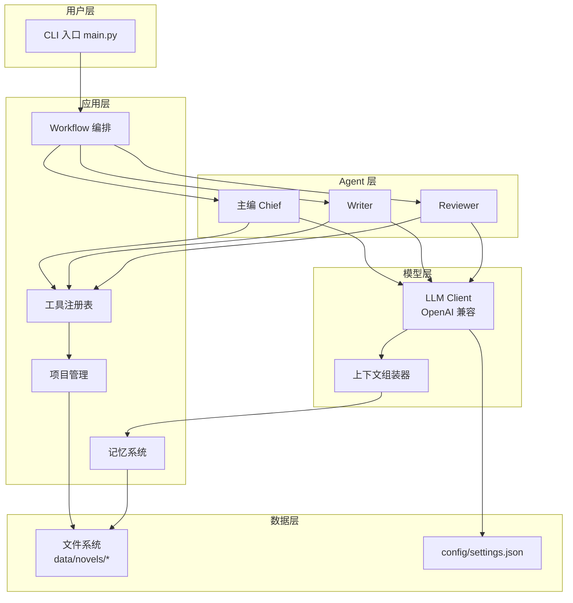
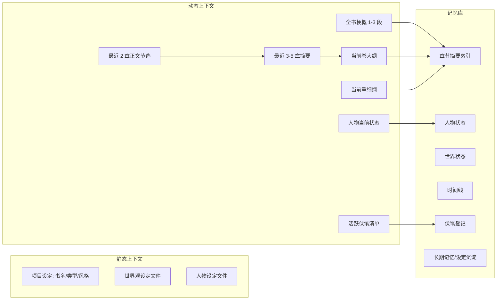
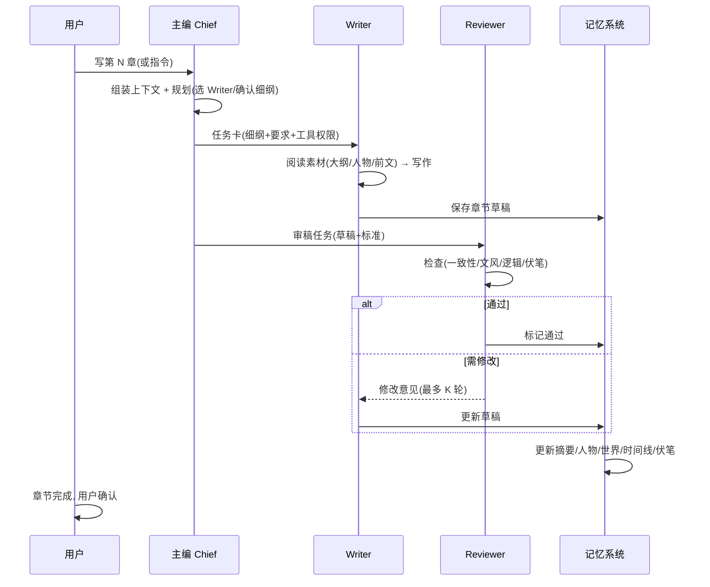

# ARCHITECTURE — 系统架构设计

## 1. 总体架构

单机单进程 CLI 应用。所有状态在本地, 无服务端。



## 2. 分层职责

| 层 | 职责 | 关键规则 |
|---|---|---|
| 用户层 | 命令解析(CLI): `novel create/chat/write/review` 等 | 不做业务逻辑 |
| 应用层 | 工作流编排、项目 CRUD、记忆读写、工具分发 | 无 AI 调用直接耦合; 可单测 |
| Agent 层 | 3 个 Agent, 每个 = 系统提示词 + 可用工具 + 循环 | 纯"提示词 + 工具调用"解释器 |
| 模型层 | 统一 API 客户端 + 上下文组装 | 只认 OpenAI 兼容协议 |
| 数据层 | 文件读写 + 配置 | 明文, 可备份 |

## 3. 核心运行循环(每轮对话/写作)

```
1. 用户输入 → 应用层路由到目标 Agent(默认主编)
2. 上下文组装器: 项目元信息 + 记忆摘要 + 最近章节摘要 + 本轮指令
   (绝不含全书正文)
3. LLM 请求(OpenAI 兼容) → 流式输出
4. Agent 循环: 若模型返回 tool_calls:
   a. 工具注册表执行(读文件/写文件/查记忆/列章节…)
   b. 工具结果回填 → 继续请求(最多 N 轮)
5. 最终文本返回用户; 若发生章节写入 → 触发记忆更新
6. 记忆更新: 章节摘要 → 人物状态/世界状态/时间线/伏笔增量更新
```

## 4. 上下文管理(长篇小说核心)

**原则: 全书永不整体进入 prompt。**



### 上下文包(默认配置, 可按需调整)

| 部分 | 来源 | 默认上限 |
|---|---|---|
| 项目元信息 | project.json | 500 字 |
| 全书梗概 | outline/summary.md | 1500 字 |
| 当前卷大纲 | outline/vol_X.md | 2000 字 |
| 当前章细纲 | outline/chapter_plan.md | 1500 字 |
| 最近章节摘要 | memory/chapter_summaries.md | 2000 字(最近 5 章) |
| 最近正文节选 | chapters/ 末尾片段 | 3000 字(最近 2 章结尾) |
| 人物状态 | memory/characters.md | 1500 字(活跃角色) |
| 世界状态 | memory/world.md | 1000 字 |
| 伏笔清单 | memory/foreshadowing.md | 800 字 |
| 长期记忆 | memory/long_term.md | 1000 字 |
| 合计 | | ≈ 15K 字内 |

> 估算: 中文约 1 字 ≈ 1.5-2 token, 默认上下文包 ≈ 25-30K token, 为长上下文模型留足余量。

### 裁剪规则

- 超过上限 → 由"摘要器"压缩(LLM 二次调用, 或规则截断 + 摘要)。
- 章节完成后: 正文 → 章节摘要(LLM 压缩) → 存入记忆; 正文本体只保留最近 2 章。
- 人物/世界状态: 每章结束后增量更新(LLM 比对旧状态 + 新章 → 新状态)。

## 5. 多 Agent 写作流(核心流程)



### 失败回退

- Writer 超时/输出为空 → 重试 1 次 → 仍失败则回报主编, 主编给用户方案。
- Reviewer 连续 3 轮修改仍不通过 → 升级给主编决策(接受/人工介入)。
- 任何 LLM 调用失败 → 明确报错, 不写坏文件(草稿原子写入)。

## 6. 错误处理与可观测性

- 所有 AI 调用记录请求/响应摘要(不含 Key)到 logs/。
- 工作流每步写 progress 日志(章节/Agent/轮次/token 估算)。
- 文件写入用"临时文件 + rename", 避免半截文件。
- 配置校验: 启动时检查 Base URL 可达性(仅 HEAD 请求, 不发数据)。

## 7. 安全

- API Key 存本地 settings.json(文件权限 600); 日志/报错绝不输出 Key。
- 不收集任何遥测; 无网络请求除用户配置的 API。
- 工具系统白名单: Agent 只能读写当前项目目录内文件(路径校验)。

## 8. 与 XingLu 的关系(干净分离)

- 本架构的"多 Agent + 记忆 + 文件化"思想来自领域公开概念与逆向研究总结, 非 XingLu 专有设计。
- 无任何代码/提示词逐字复制自 XingLu; 提示词模板全部为本设计原创撰写。
- 本软件不提供、不调用 XingLu 任何服务。
