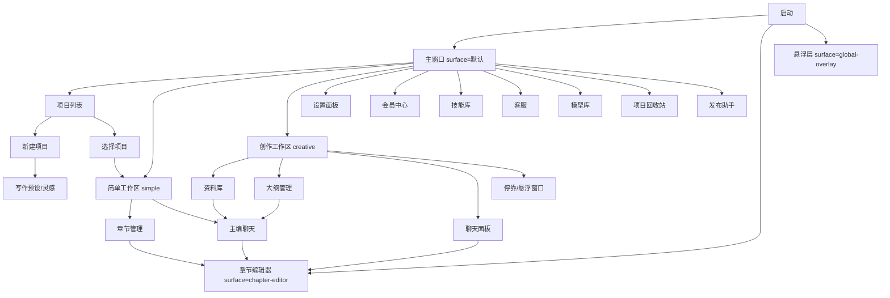

# 07 — 路由/导航恢复报告 (Routes)

## 结论

XingLu 是 Electron 多窗口 SPA,**无 URL 路由**(无 react-router/vue-router 特征 [CONFIRMED])。
导航 = 视图状态切换 + 窗口管理 + IPC 消息。

## 1. 导航机制 [CONFIRMED]

1. **Surface 分发** (入口): `mountRendererApp(surface)`
   - `chapter-editor` → 章节编辑器
   - `global-overlay` → 悬浮层
   - 默认 → 主应用
2. **视图切换**: React 状态(useState)驱动 — 主工作区按当前项目/当前视图渲染
3. **窗口导航**: 主进程 `novelforge:window:*` IPC(最小化/关闭/切换/停靠)
4. **全局悬浮层**: 主进程持有 `global-overlay-view` 状态, 渲染器切换会话
5. **章节编辑器**: 主进程 `chapter-editor-view` 状态(layout: docked/floating)

## 2. 页面导航图 (Mermaid)



## 3. 关键导航事件 (IPC)

| 事件 | 触发 |
|---|---|
| `novelforge:window:set-chapter-editor-docked` | 章节编辑器停靠切换 |
| `novelforge:chapter-editor-view:set-session` | 打开章节会话 |
| `novelforge:global-overlay-view:set-sessions` | 切换悬浮会话 |
| `novelforge:projects:select` | 切换当前项目(广播 changed) |
| `novelforge:window:close/minimize/toggle-maximize` | 窗口控制 |
| `novelforge:window:set-minimum-size` | 窗口大小 |

## 4. 移动端导航 [CONFIRMED]

PWA 无路由库, 视图状态切换: 连接页 → 项目页 → 聊天页 / 资料页 / 章节页 / 生成页 / 设置页

```
连接页 → 项目页 → 聊天页
                ├→ 资料页
                ├→ 章节页
                ├→ 生成页(图片/音乐)
                └→ 设置页
```

## 5. 判定

- URL 路由: **不存在** [CONFIRMED]
- 状态路由: React context + IPC [CONFIRMED]
- 多窗口: 3 个业务窗口 + 1 个隐藏发布窗口 [CONFIRMED]
