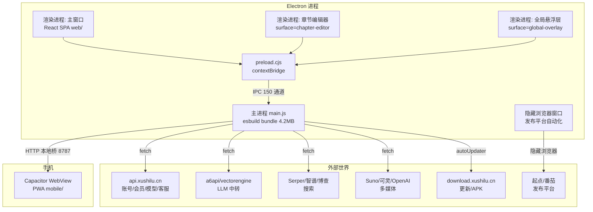
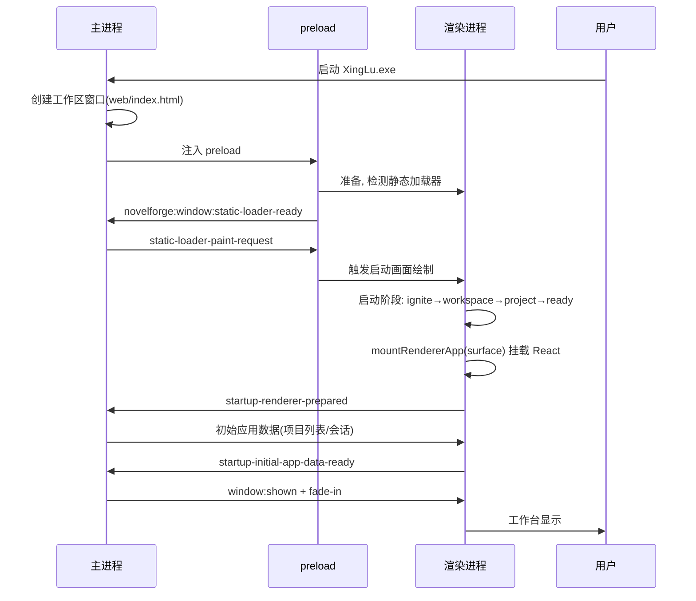
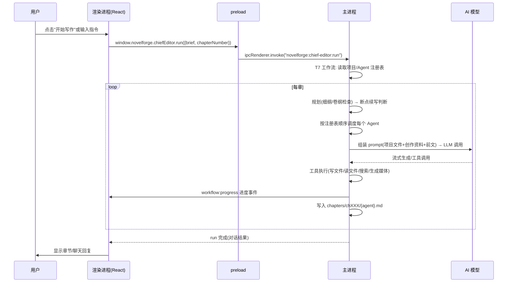
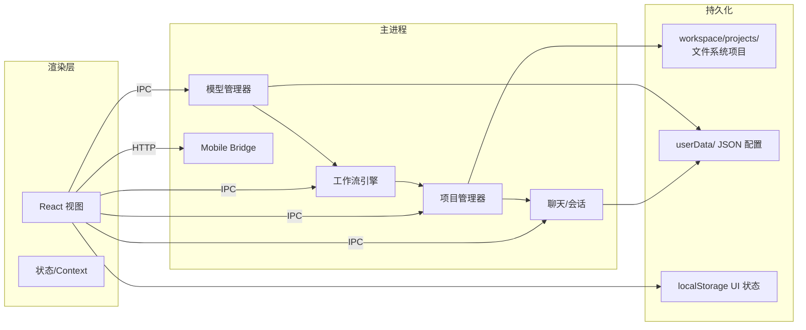
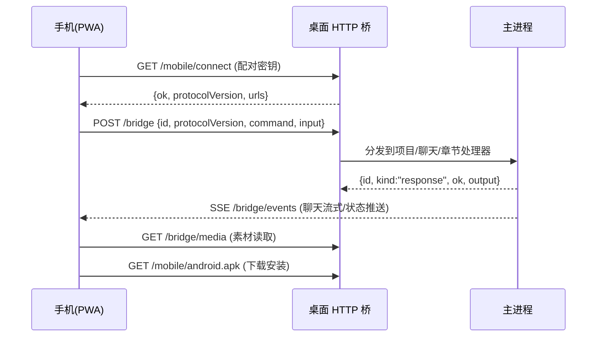

# 16 — 软件整体架构报告 (Architecture)

> 目标: 让没读过项目的人也能理解星炉(XingLu)如何运行。

## 1. 一句话架构

星炉是一个 **Electron 桌面应用**: 前端是 React 单页应用, 通过 preload 暴露的 IPC 桥调用主进程; 主进程持有全部业务逻辑(项目文件系统、AI 模型调度、本地 HTTP 服务器), 所有网络请求只在主进程发出。移动端是配套的 Capacitor PWA, 通过局域网 HTTP 桥连接桌面端协同工作。

## 2. 进程模型



## 3. 启动流程



## 4. 用户操作流(以"让主编写一章"为例)



## 5. 网络层架构

```
所有网络请求只在主进程
├── 官方 API 封装 gEe(): POST/GET + Bearer token + ok 校验
│     api.xushilu.cn (备用 119.45.39.251)
├── LLM 客户端(多提供商)
│     OpenAI 兼容(chat/completions) | Anthropic | Gemini
│     + 适配器层(kdt): 按模型 ID 自动选择参数(thinking/effort/max_tokens)
│     + 401 自动刷新 API Key
├── 搜索网关
│     Serper / 智谱 / 博查 / 统一网关(v1/search)
├── 媒体生成
│     OpenAI 图像 / Suno 音乐 / 可灵视频(任务轮询)
├── 本地 HTTP 服务器(mobile bridge)
│     /bridge 命令 + SSE 事件 + 媒体 + APK 分发
└── 更新服务 electron-updater
```

## 6. 数据流全景



## 7. 移动端协同



## 8. 安全边界

- 渲染进程**无直接网络/文件权限**(sandbox), 全部经 IPC
- preload 只暴露白名单 API(contextBridge)
- mobile bridge 用配对密钥(18 字节随机, base64url)鉴权
- 项目文件按工作区根目录隔离(projects/ 布局)
- 无自研原生代码, 无系统级提权

## 9. 启动/更新/发布附加组件

- 启动: NSIS 安装器(7z 解压) → Electron → app.asar
- 更新: electron-updater (generic provider, download.xushilu.cn)
- 发布: 隐藏 BrowserWindow + AI 工具(读页面/点击/填充)
- 图像处理: sharp (libvips)
- Office 文档: mammoth/jszip 内嵌(docx 提取)
